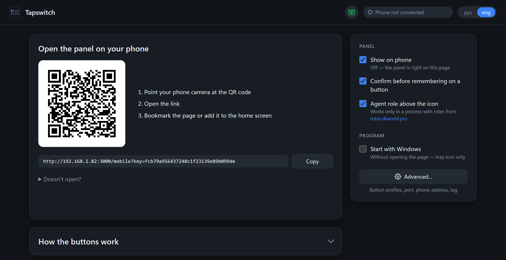
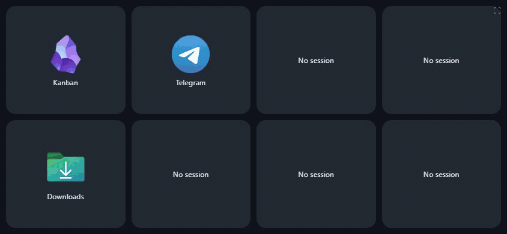
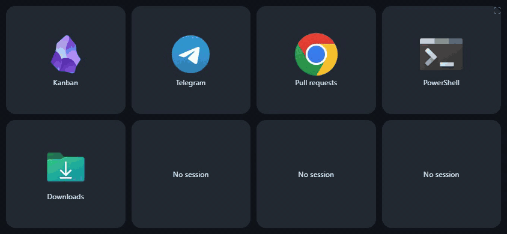
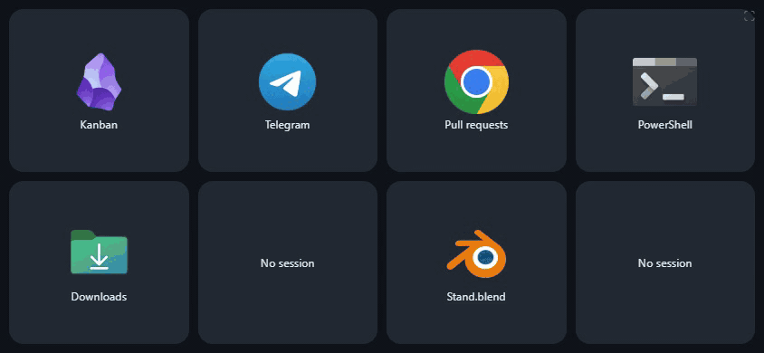
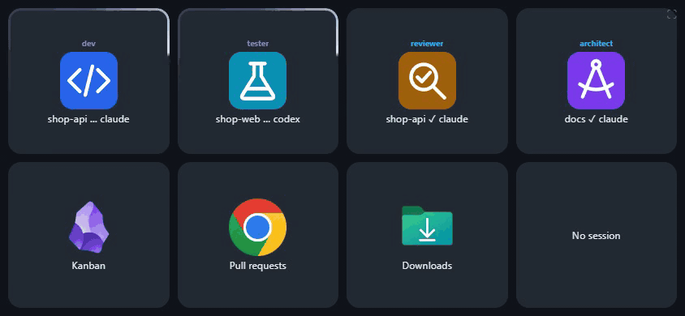
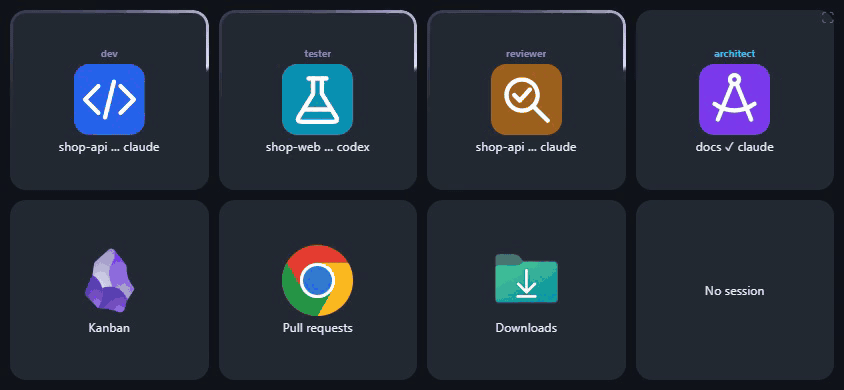

<p align="center">
  
</p>

<p align="center">
  <a href="README.md">Русский</a> · <b>English</b>
</p>

# Tapswitch

**Your phone as a Stream Dock for Windows.** Put the phone on a stand next to the monitor. One tap takes you to the right window, browser tab or AI agent session. The buttons also show what each agent is doing.

- **Nothing to install on the phone.** The panel opens in the phone's browser from a QR code. Works on Android and iPhone.
- **One tap to remember.** Tap an empty button and it remembers the window you were just in. Tap it again later to jump back.
- **Live agent status.** For [herdr](https://github.com/ogulcancelik/herdr) sessions the button shows whether the agent (Claude Code, Codex, …) is working, finished, or waiting for you.
- **Tiny and portable.** One 1.5 MB `.exe` with no installer and no dependencies. It runs from the system tray.

## Quick start

1. Download [tapswitch.exe](https://github.com/DmitryMok/tapswitch/releases/latest/download/tapswitch.exe) and run it.
2. The control page opens in your browser. Scan the QR code with your phone, and the button panel opens on the phone.
3. **Assign a window to a button.** On the computer, switch to the program you want to come back to quickly (an editor, a terminal with an agent, Obsidian…). While its window is active, tap an empty button on the phone. The button remembers that window.
4. **Switch.** Now, from any other window, tap that button and the computer switches to the remembered window. Fill the other buttons the same way.
5. *Optional:* to put browser tabs on buttons, [install the extension](#browser-extension-for-tabs). It takes a minute.

The phone and the computer must be on the same Wi-Fi network.

<p align="center">
  
</p>

> **Windows warning on first run.** The exe is not code-signed, so SmartScreen shows "Windows protected your PC". Click **More info → Run anyway**. Windows Firewall will then ask for network access. Allow it for **private networks**, otherwise the phone can't connect.
>
> You can also build the exe yourself from this source (see [Building](#building)).

## Browser extension for tabs

You only need it to put individual browser tabs on buttons. Program windows, agent sessions and key combinations work without it. The extension is not in browser stores; you install it manually, once per browser:

1. Download [tapswitch-browser-extension.zip](https://github.com/DmitryMok/tapswitch/releases/latest/download/tapswitch-browser-extension.zip) and unpack it to a permanent folder, e.g. `%LOCALAPPDATA%\Tapswitch`. The browser loads the extension from this folder on every start, so don't delete or move it.
2. Open `chrome://extensions` (`edge://extensions`, `opera://extensions`, …) and turn on **Developer mode**.
3. Click **Load unpacked** and select the `browser_extension` folder.

A tab is assigned the same way as a window: open it in the browser and tap an empty button on the phone.

Works with any Chromium 116+ browser (Chrome, Edge, Opera, Brave, Vivaldi, Comet). The extension connects only to `127.0.0.1` and sends the list of open tabs to Tapswitch. Details are in [app/browser_extension/README.md](app/browser_extension/README.md) (in Russian).

## What can a button open?

| Button | How to set it |
|---|---|
| Any program window | Make the window active on the computer, then tap an empty button |
| Browser tab (Chrome, Edge, Opera, Brave, …) | **Needs the [extension](#browser-extension-for-tabs)** (1 minute); then open the tab and tap an empty button |
| herdr session with an AI agent | Focus the session's terminal tab, then tap |
| DeepSeek Harness session | Open the session in the app, then tap |
| OpenCode Desktop session tab | Open the tab in the app, then tap |
| Key combination (e.g. <kbd>Win</kbd>+<kbd>H</kbd> for voice typing) | Right-click the button on the control page |

## Gestures

### Tap

Opens the button's window or session. An empty button remembers the window you are working in right now.

<p align="center">
  
</p>

### Hold

Replaces the button's window or session with the current one.

<p align="center">
  
</p>

### Drag

Hold a button and move it to another place: the two buttons swap.

<p align="center">
  
</p>

### Swipe left / right

Switches the profile — another set of buttons (6 in total).

<p align="center">
  
</p>

### More

- **Double tap** clears the button.
- **Swipe down** reloads the panel.

On the control page you can change a button's caption, color and icon (built-in library, emoji, or your own image).

A button bound to an app window shows the icon the window currently has on the taskbar when it differs from the exe icon — for example, Chrome's profile badge or a counter or status the app draws on its icon. The button icon updates along with the window.

## Agent status on buttons

For [herdr](https://github.com/ogulcancelik/herdr) sessions, both in Windows and in WSL:

- **working:** a light runs around the button;
- **done:** a check mark that slowly fades;
- **waiting for you:** an orange pulsing frame;
- **ready:** the caption shows `✓ claude`, `✓ codex`, ….

<p align="center">
  
</p>

The button of the session you are in now is framed. If a session or program was closed, the button shows that too. After a reboot, Tapswitch finds the sessions again on its own.

<details>
<summary><b>Agent roles above the icon</b></summary>

If a session's folder is a role folder such as `my-project/06 Roles/dev` (a numbered `NN Roles` folder), Tapswitch shows the project as the caption and the role above the icon, with an icon for the role.
</details>

<details>
<summary><b>Phone doesn't open the panel?</b></summary>

- The phone and the computer must be on the same Wi-Fi network.
- Allow Tapswitch in the Windows Firewall prompt (private networks).
- A VPN on the phone or the computer may block the home network.
- If the computer has several network adapters (VPN, WSL, Hyper-V), set the right address under **Advanced** on the control page.
</details>

<details>
<summary><b>Settings and data</b></summary>

- Data and settings are stored in `%APPDATA%\Tapswitch\`: `state.json`, `config.yaml` (only what differs from the [defaults](app-rs/defaults/config.yaml)), custom scenarios, and the log.
- Port, phone address, profiles and autostart can be changed under **Advanced** on the control page.
- Interface languages: English and Russian.
</details>

## Building

Requirements: Windows, Rust (GNU toolchain `x86_64-pc-windows-gnu`, no Visual Studio needed), and [MSYS2](https://www.msys2.org/) with the `mingw-w64-x86_64-binutils` package (for `as.exe` and `dlltool.exe`).

```bat
app-rs\build.cmd          :: release build → app-rs\target\release\tapswitch.exe
app-rs\build.cmd test     :: tests
```

If MSYS2 is not in `C:\msys64`, set `MINGW=<folder with as.exe>`.

The repository layout:

- `app-rs/`: the Rust source code;
- `app/`: resources that are embedded into the exe at build time: the phone panel page, PowerShell helpers, role icons, button scenarios, and the browser extension.

## License

[MIT](LICENSE). Icons from [Lucide](https://lucide.dev) are used under the [ISC license](app-rs/assets/LUCIDE-LICENSE.txt).
