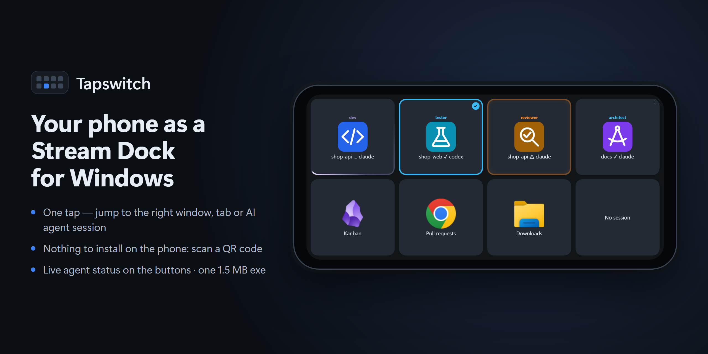
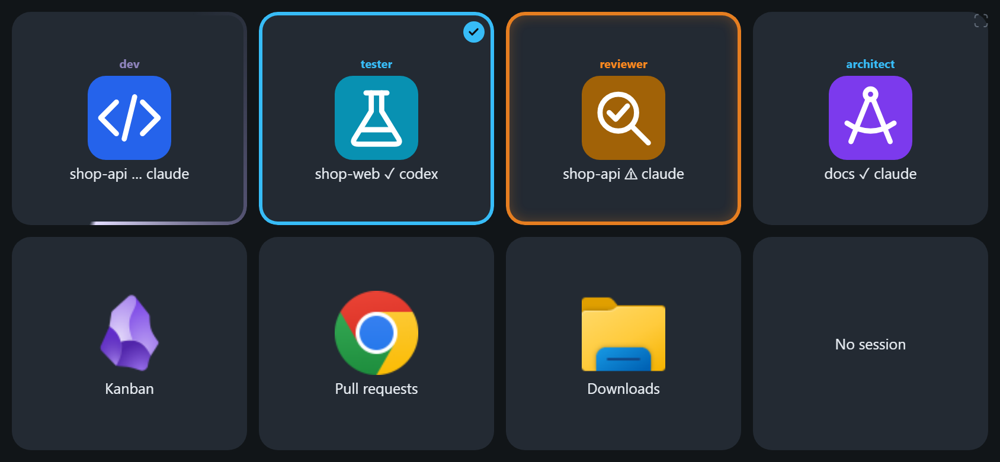

<p align="center">
  
</p>

<p align="center">
  <a href="README.md">Русский</a> · <b>English</b>
</p>

# Tapswitch

**Your phone as a Stream Dock for Windows.** Put the phone on a stand next to the monitor. One tap takes you to the right window, browser tab or AI agent session. The buttons also show what each agent is doing.

- **Nothing to install on the phone.** The panel opens in the phone's browser from a QR code. Works on Android and iPhone.
- **One tap to remember.** Tap an empty button and it remembers the window you were just in. Tap it again later to jump back.
- **Live agent status.** For [herdr](https://github.com/ogulcancelik/herdr) sessions the button shows whether the agent (Claude Code, Codex, …) is working, finished, or waiting for you.
- **Tiny and portable.** One 1.5 MB `.exe` with no installer and no dependencies. It runs from the system tray.

## Quick start

1. Download `tapswitch.exe` from [Releases](../../releases/latest) and run it.
2. The control page opens in your browser. Scan the QR code with your phone.
3. Switch to any window, then tap an empty button on the phone. Done.

The phone and the computer must be on the same Wi-Fi network.

<p align="center">
  
</p>

> **Windows warning on first run.** The exe is not code-signed, so SmartScreen shows "Windows protected your PC". Click **More info → Run anyway**. Windows Firewall will then ask for network access. Allow it for **private networks**, otherwise the phone can't connect.
>
> You can also build the exe yourself from this source (see [Building](#building)).

## What can a button open?

| Button | How to set it |
|---|---|
| Any program window | Switch to the window, then tap an empty button |
| Browser tab (Chrome, Edge, Opera, Brave, …) | Install the browser extension (see below) |
| herdr session with an AI agent | Focus the session's terminal tab, then tap |
| DeepSeek Harness session | Open the session in the app, then tap |
| Key combination (e.g. <kbd>Win</kbd>+<kbd>H</kbd> for voice typing) | Right-click the button on the control page |

<p align="center">
  
</p>

## Gestures

| Gesture | Action |
|---|---|
| Tap | Open the button's window or session. On an empty button, remember the current one |
| Hold | Replace the button's window or session with the current one |
| Double tap | Clear the button |
| Drag | Move the button |
| Swipe left / right | Switch button profiles (6 sets of buttons) |
| Swipe down | Reload the panel |

On the control page you can change a button's caption, color and icon (built-in library, emoji, or your own image).

<details>
<summary><b>Agent status on buttons</b></summary>

For [herdr](https://github.com/ogulcancelik/herdr) sessions, both in Windows and in WSL:

- **working:** a light runs around the button;
- **done:** a check mark that slowly fades;
- **waiting for you:** an orange pulsing frame;
- **ready:** the caption shows `✓ claude`, `✓ codex`, ….

The button of the session you are in now is framed. If a session or program was closed, the button shows that too. After a reboot, Tapswitch finds the sessions again on its own.
</details>

<details>
<summary><b>Browser tabs: install the extension</b></summary>

The extension is installed manually. It is not published in browser stores.

1. Download `tapswitch-browser-extension.zip` from [Releases](../../releases/latest). Unpack it to a permanent folder, e.g. `%LOCALAPPDATA%\Tapswitch\browser_extension`.
2. Open `chrome://extensions` (`edge://extensions`, `opera://extensions`, …) and turn on **Developer mode**.
3. Click **Load unpacked** and select the `browser_extension` folder.

The extension connects only to `127.0.0.1` and sends the list of open tabs to Tapswitch. It works with any Chromium 116+ browser. Details are in [app/browser_extension/README.md](app/browser_extension/README.md) (in Russian).
</details>

<details>
<summary><b>Agent roles above the icon</b></summary>

If a session's folder is a role folder such as `my-project/06 Roles/dev` (a numbered `NN Roles` folder), Tapswitch shows the project as the caption and the role above the icon, with an icon for the role. This follows the agent workflow from [tutor.diworld.pro](https://tutor.diworld.pro).
</details>

<details>
<summary><b>Phone doesn't open the panel?</b></summary>

- The phone and the computer must be on the same Wi-Fi network.
- Allow Tapswitch in the Windows Firewall prompt (private networks).
- A VPN on the phone or the computer may block the home network.
- If the computer has several network adapters (VPN, WSL, Hyper-V), set the right address under **Advanced** on the control page.
</details>

<details>
<summary><b>Settings and data</b></summary>

- Data and settings are stored in `%APPDATA%\Tapswitch\`: `state.json`, `config.yaml` (only what differs from the [defaults](app-rs/defaults/config.yaml)), custom scenarios, and the log.
- Port, phone address, profiles and autostart can be changed under **Advanced** on the control page.
- Interface languages: English and Russian.
</details>

## Building

Requirements: Windows, Rust (GNU toolchain `x86_64-pc-windows-gnu`, no Visual Studio needed), and [MSYS2](https://www.msys2.org/) with the `mingw-w64-x86_64-binutils` package (for `as.exe` and `dlltool.exe`).

```bat
app-rs\build.cmd          :: release build → app-rs\target\release\tapswitch.exe
app-rs\build.cmd test     :: tests
```

If MSYS2 is not in `C:\msys64`, set `MINGW=<folder with as.exe>`.

The repository layout:

- `app-rs/`: the Rust source code;
- `app/`: resources that are embedded into the exe at build time: the phone panel page, PowerShell helpers, role icons, button scenarios, and the browser extension.

## License

[MIT](LICENSE). Icons from [Lucide](https://lucide.dev) are used under the [ISC license](app-rs/assets/LUCIDE-LICENSE.txt).
