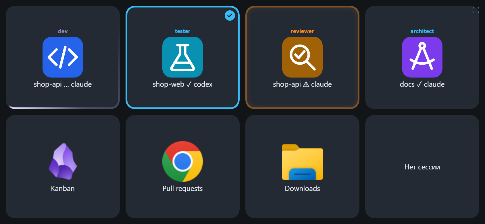

<p align="center">
  
</p>

<p align="center">
  <b>Русский</b> · <a href="README.en.md">English</a>
</p>

# Tapswitch

**Stream Dock из телефона для Windows.** Поставьте телефон на подставку у монитора. Одно касание переносит вас в нужное окно, вкладку браузера или сессию ИИ-агента. Заодно кнопки показывают, чем занят каждый агент.

- **На телефон ничего не ставится.** Панель открывается в браузере телефона по QR-коду. Подходят Android и iPhone.
- **Запомнить окно одним касанием.** Нажмите пустую кнопку, и она запомнит окно, в котором вы только что работали. Потом нажмите её снова, чтобы вернуться в это окно.
- **Статус агентов на кнопках.** Для сессий [herdr](https://github.com/ogulcancelik/herdr) кнопка показывает, что агент (Claude Code, Codex, …) работает, закончил или ждёт вашего ответа.
- **Маленькая и переносимая.** Один `.exe` на 1,5 МБ, без установщика и зависимостей. Работает из трея.

## Быстрый старт

1. Скачайте `tapswitch.exe` из [Releases](../../releases/latest) и запустите.
2. В браузере откроется страница управления. Наведите камеру телефона на QR-код.
3. Перейдите в любое окно и нажмите пустую кнопку на телефоне. Готово.

Телефон и компьютер должны быть в одной Wi-Fi сети.

<p align="center">
  
</p>

> **Предупреждение Windows при первом запуске.** У exe нет цифровой подписи, поэтому SmartScreen покажет «Windows защитила ваш компьютер». Нажмите **Подробнее → Выполнить в любом случае**. Затем брандмауэр попросит доступ к сети. Разрешите его для **частных сетей**, иначе телефон не подключится.
>
> Exe можно собрать и самому из этих исходников (см. [Сборка](#сборка)).

## Что можно открыть кнопкой

| Кнопка | Как назначить |
|---|---|
| Окно любой программы | Перейти в окно и нажать пустую кнопку |
| Вкладка браузера (Chrome, Edge, Opera, Brave, …) | Установить расширение (см. ниже) |
| Сессия herdr с ИИ-агентом | Перейти во вкладку терминала с сессией и нажать |
| Сессия DeepSeek Harness | Открыть сессию в приложении и нажать |
| Сочетание клавиш (например, <kbd>Win</kbd>+<kbd>H</kbd> — голосовой ввод) | Правый клик по кнопке на странице управления |

<p align="center">
  
</p>

## Жесты

| Жест | Действие |
|---|---|
| Касание | Открыть окно или сессию кнопки. На пустой кнопке — запомнить текущее окно или сессию |
| Удержание | Заменить окно или сессию кнопки на текущие |
| Двойное касание | Очистить кнопку |
| Перетаскивание | Переставить кнопку |
| Свайп влево / вправо | Сменить профиль кнопок (6 наборов) |
| Свайп вниз | Перезагрузить панель |

На странице управления у кнопки можно поменять подпись, цвет и иконку: из встроенной библиотеки, эмодзи или свою картинку.

<details>
<summary><b>Статус агента на кнопке</b></summary>

Для сессий [herdr](https://github.com/ogulcancelik/herdr), в Windows и в WSL:

- **работает:** по краю кнопки бежит огонёк;
- **закончил:** галочка, которая постепенно бледнеет;
- **ждёт вашего ответа:** мигающая оранжевая рамка;
- **готов:** в подписи `✓ claude`, `✓ codex`, ….

Кнопка сессии, в которой вы сейчас находитесь, обведена рамкой. Если сессию или программу закрыли, это тоже видно на кнопке. После перезагрузки компьютера Tapswitch сам находит сессии заново.
</details>

<details>
<summary><b>Вкладки браузера: установка расширения</b></summary>

Расширение ставится вручную, в магазинах браузеров его нет.

1. Скачайте `tapswitch-browser-extension.zip` из [Releases](../../releases/latest). Распакуйте его в постоянную папку, например `%LOCALAPPDATA%\Tapswitch\browser_extension`.
2. Откройте `chrome://extensions` (`edge://extensions`, `opera://extensions`, …) и включите **Режим разработчика**.
3. Нажмите **Загрузить распакованное** и выберите папку `browser_extension`.

Расширение подключается только к `127.0.0.1` и передаёт Tapswitch список открытых вкладок. Подходит любой браузер на Chromium 116+. Подробнее — в [app/browser_extension/README.md](app/browser_extension/README.md).
</details>

<details>
<summary><b>Роли агентов над иконкой</b></summary>

Если папка сессии — папка роли, например `my-project/06 Roles/dev` (папка `NN Roles` с номером), Tapswitch пишет в подписи проект, а над иконкой — роль и подбирает для роли иконку. Так устроен процесс работы с агентами из [tutor.diworld.pro](https://tutor.diworld.pro).
</details>

<details>
<summary><b>Панель не открывается на телефоне?</b></summary>

- Телефон и компьютер должны быть в одной Wi-Fi сети.
- Разрешите Tapswitch доступ в окне брандмауэра Windows (частные сети).
- VPN на телефоне или компьютере может закрывать доступ к домашней сети.
- Если у компьютера несколько сетевых адаптеров (VPN, WSL, Hyper-V), укажите нужный адрес в разделе **Дополнительно** на странице управления.
</details>

<details>
<summary><b>Настройки и данные</b></summary>

- Данные и настройки хранятся в `%APPDATA%\Tapswitch\`: `state.json`, `config.yaml` (только отличия от [настроек по умолчанию](app-rs/defaults/config.yaml)), свои сценарии и журнал.
- Порт, адрес для телефона, профили и автозапуск меняются в разделе **Дополнительно** на странице управления.
- Языки интерфейса: русский и английский.
</details>

## Сборка

Нужны Windows, Rust (тулчейн GNU `x86_64-pc-windows-gnu`, Visual Studio не нужна) и [MSYS2](https://www.msys2.org/) с пакетом `mingw-w64-x86_64-binutils` (из него берутся `as.exe` и `dlltool.exe`).

```bat
app-rs\build.cmd          :: сборка → app-rs\target\release\tapswitch.exe
app-rs\build.cmd test     :: тесты
```

Если MSYS2 установлен не в `C:\msys64`, задайте `MINGW=<папка с as.exe>`.

Что где лежит:

- `app-rs/` — исходный код на Rust;
- `app/` — ресурсы, которые при сборке встраиваются в exe: страница панели телефона, вспомогательные скрипты PowerShell, иконки ролей, сценарии кнопок, а также расширение браузера.

## Лицензия

[MIT](LICENSE). Иконки [Lucide](https://lucide.dev) — по [лицензии ISC](app-rs/assets/LUCIDE-LICENSE.txt).
